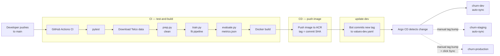
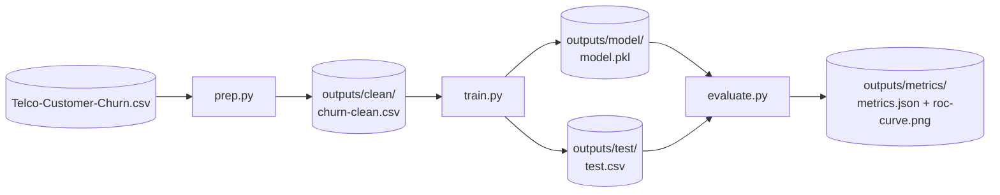

[README).md](https://github.com/user-attachments/files/33449449/README.1.md)
# Customer Churn Prediction — End-to-End MLOps Pipeline

Predict whether a telecom customer is about to leave, and ship that prediction as a production-style API — trained, tested, containerised, and deployed to Kubernetes automatically on every push.

This repo is less about the model and more about **everything around it**: a reproducible training pipeline, automated tests, CI/CD with GitHub Actions, a Docker image in Azure Container Registry, a Helm chart, and GitOps deployments with Argo CD across `dev`, `staging` and `production`.

---

## Table of contents

- [What it does](#what-it-does)
- [How the whole flow works](#how-the-whole-flow-works)
- [Tech stack](#tech-stack)
- [Repository structure](#repository-structure)
- [The ML pipeline](#the-ml-pipeline)
- [The prediction API](#the-prediction-api)
- [Run it locally](#run-it-locally)
- [CI/CD — GitHub Actions](#cicd--github-actions)
- [Deployment — Helm + Argo CD (GitOps)](#deployment--helm--argo-cd-gitops)
- [Promoting a release](#promoting-a-release)
- [Configuration reference](#configuration-reference)

---

## What it does

A subscription business loses money every time a customer cancels. If you can spot likely churners early, you can offer them a discount or a call before they go.

This project:

1. Takes the public **IBM Telco Customer Churn** dataset (~7,000 customers, 20 attributes such as contract type, tenure, monthly charges, services used).
2. Cleans it and trains a **logistic regression** classifier inside a scikit-learn pipeline.
3. Evaluates it (AUC, accuracy, precision, recall, F1, ROC curve).
4. Serves it through a **FastAPI** endpoint: send one customer's details, get back a churn probability and a yes/no decision.
5. Packages and deploys the API to **Azure Kubernetes Service** with no manual steps for `dev`, and a deliberate human approval for `production`.

---

## How the whole flow works



In plain words:

1. **You push code** to `main` (or open a pull request).
2. **CI** runs the unit tests, then rebuilds the model from scratch: download data → clean → train → evaluate. The trained `model.pkl` is uploaded as a build artifact.
3. **CD** (only on `main`) downloads that exact model, bakes it into a Docker image, and pushes it to Azure Container Registry tagged with the **git commit SHA** (plus `latest`).
4. **GitOps hand-off**: a bot commit writes the new SHA into `churn-api/values-dev.yaml`. CI never talks to the cluster directly.
5. **Argo CD**, running inside the cluster, watches this repo. It sees the changed tag and rolls the new image out to `churn-dev` automatically.
6. After a Helm install/upgrade, a **smoke-test Job** hits `/health` to confirm the service is up.
7. **Staging and production** are promoted by changing the tag in their values files. Staging syncs automatically; production waits for someone to click **Sync** in Argo CD.

Because the cluster state is defined entirely in Git, every deployment is a commit you can see, review and revert.

---

## Tech stack

| Area | Tools |
|---|---|
| Data & ML | pandas, scikit-learn, matplotlib |
| Serving | FastAPI, Pydantic, Uvicorn |
| Testing | pytest, FastAPI `TestClient` |
| Container | Docker (`python:3.14-slim`) |
| CI/CD | GitHub Actions |
| Registry | Azure Container Registry (ACR) |
| Orchestration | Kubernetes (AKS), Helm |
| GitOps | Argo CD (`Application`, `ApplicationSet`) |

---

## Repository structure

```
churn-mlops1/
├── src/serve/
│   ├── prep.py           # Step 1: clean raw CSV
│   ├── train.py          # Step 2: build + fit the sklearn pipeline, save model.pkl
│   ├── evaluate.py       # Step 3: score on held-out data, write metrics.json + ROC plot
│   ├── main.py           # FastAPI app (/health, /predict)
│   └── schema.py         # Pydantic request/response models
│
├── tests/
│   ├── test_prep.py      # cleaning rules
│   ├── test_model.py     # pipeline trains and predicts 0/1
│   └── test_api.py       # bad input is rejected with 422
│
├── notebooks/
│   └── exploration.ipynb # initial data exploration
│
├── churn-api/            # Helm chart
│   ├── Chart.yaml
│   ├── values.yaml               # shared defaults
│   ├── values-dev.yaml           # dev overrides (tag updated by CI)
│   ├── values-staging.yaml
│   ├── values-production.yaml
│   └── templates/
│       ├── deployment.yaml       # pods, probes, env vars
│       ├── service.yaml          # ClusterIP / LoadBalancer
│       ├── ingress.yaml          # optional
│       ├── smoke-test-job.yaml   # post-deploy /health check
│       └── _helpers.tpl
│
├── applicationset.yaml           # Argo CD: generates dev + staging apps
├── production-application.yaml   # Argo CD: production app (manual sync)
├── root-application.yaml         # Argo CD: app-of-apps pointing at argocd-apps/
├── argocd-apps/                  # child Argo CD applications
│
├── .github/workflows/ci.yml      # CI/CD pipeline
├── Dockerfile
├── requirements.txt
└── pytest.ini
```

---

## The ML pipeline

The three scripts run in sequence; each one's output folder is the next one's input.



### 1. `prep.py` — cleaning only

Fixes the issues found during exploration:

- drops the `customerID` column (an identifier, not a signal),
- converts `TotalCharges` to a number (blank strings in the raw data become `NaN`),
- maps the `Churn` label from `Yes`/`No` to `1`/`0`,
- fills missing numeric values (`tenure`, `MonthlyCharges`, `TotalCharges`) with `0` — these are brand-new customers with no billing history yet,
- removes duplicate rows.

Encoding and scaling are **deliberately not done here** (see next step).

### 2. `train.py` — one pipeline, preprocessing included

- **Stratified 80/20 split** so train and test have the same churn rate (`random_state=42`).
- Builds a scikit-learn `Pipeline`:
  - numeric columns → median imputation → `StandardScaler`
  - categorical columns → most-frequent imputation → `OneHotEncoder(handle_unknown="ignore")`
  - model → `LogisticRegression(class_weight="balanced")`, with regularisation controlled by `--reg_rate` (`C = 1 / reg_rate`).
- Saves the whole fitted pipeline as `model.pkl`, and the untouched test split as `test.csv`.

**Why preprocessing lives inside the model:** the encoder and scaler are fitted on training data only (no leakage), and they travel with the model. That is why the API can accept raw values like `"Month-to-month"` directly — no separate feature-engineering code has to be kept in sync at serving time.

`class_weight="balanced"` is used because churners are the minority class (~26%); without it the model would lean towards predicting "stays".

### 3. `evaluate.py` — scoring

Computes AUC, accuracy, precision, recall and F1 on the held-out split, writes them to `metrics.json`, saves `roc-curve.png`, and prints a business-flavoured confusion matrix:

- **false positive** → a discount was offered to someone who was going to stay,
- **false negative** → a customer left and nobody acted.

`metrics.json` is written to a file so an automated step can later read it and block deployment of a weaker model.

---

## The prediction API

`src/serve/main.py` loads `model.pkl` once at start-up and exposes:

| Method | Path | Purpose |
|---|---|---|
| `GET` | `/health` | Liveness/readiness check. Returns `{"status": "ok", "model_loaded": true}` |
| `POST` | `/predict` | Predict churn for one customer |
| `GET` | `/docs` | Interactive Swagger UI (FastAPI built-in) |

Input is validated by Pydantic (`schema.py`). For example, `Contract` must be one of `Month-to-month`, `One year`, `Two year`; anything else returns **HTTP 422**. If the model file is missing, `/predict` returns **HTTP 503** instead of crashing.

**Example request**

```bash
curl -X POST http://localhost:8000/predict \
  -H "Content-Type: application/json" \
  -d '{
    "gender": "Female",
    "SeniorCitizen": 0,
    "Partner": "No",
    "Dependents": "No",
    "tenure": 1,
    "PhoneService": "Yes",
    "MultipleLines": "No",
    "InternetService": "Fiber optic",
    "OnlineSecurity": "No",
    "OnlineBackup": "No",
    "DeviceProtection": "No",
    "TechSupport": "No",
    "StreamingTV": "Yes",
    "StreamingMovies": "Yes",
    "Contract": "Month-to-month",
    "PaperlessBilling": "Yes",
    "PaymentMethod": "Electronic check",
    "MonthlyCharges": 94.4,
    "TotalCharges": 94.4
  }'
```

**Example response**

```json
{ "churn": 1, "probability": 0.8731, "threshold": 0.5 }
```

`churn` is `1` when `probability >= threshold`. The threshold is set by the `DECISION_THRESHOLD` environment variable, so the business can trade off "catch more churners" against "hand out fewer unnecessary discounts" **without retraining**.

---

## Run it locally

**Prerequisites:** Python 3.14 (matches CI and the Docker image), Docker (optional).

```bash
# 1. Clone and install
git clone https://github.com/UdayVempalli/churn-mlops1.git
cd churn-mlops1
python -m venv .venv && source .venv/bin/activate   # Windows: .venv\Scripts\activate
pip install -r requirements.txt

# 2. Run the tests
pytest -v

# 3. Get the data
mkdir -p data/raw
curl -sSL -o data/raw/Telco-Customer-Churn.csv \
  https://raw.githubusercontent.com/IBM/telco-customer-churn-on-icp4d/master/data/Telco-Customer-Churn.csv

# 4. Prep → train → evaluate
python src/serve/prep.py     --input_data data/raw/Telco-Customer-Churn.csv --output_data outputs/clean
python src/serve/train.py    --training_data outputs/clean --reg_rate 0.1 \
                             --model_output outputs/model --test_data_output outputs/test
python src/serve/evaluate.py --model_input outputs/model --test_data outputs/test --output_dir outputs/metrics

# 5. Start the API
uvicorn src.serve.main:app --reload
# open http://localhost:8000/docs
```

**Or with Docker** (after step 4, since the image copies `outputs/model/model.pkl`):

```bash
docker build -t churn-api .
docker run -p 8000:8000 -e DECISION_THRESHOLD=0.5 churn-api
```

> `data/`, `outputs/` and `*.pkl` are git-ignored on purpose: data and models are regenerated by the pipeline, never committed.

---

## CI/CD — GitHub Actions

Defined in `.github/workflows/ci.yml`. It runs on every pull request to `main`, and on pushes to `main` that touch code, tests, the Dockerfile or dependencies.

| Job | Runs on | What it does |
|---|---|---|
| `test-and-build` | PRs and `main` | Install deps → `pytest` → download data → prep → train → evaluate → print metrics → upload `model.pkl` as an artifact → `docker build` |
| `push-image` | `main` only | Download the **same** `model.pkl` (no retraining) → Azure login → build and push `churn-api:<commit-sha>` and `churn-api:latest` to ACR |
| `update-dev` | `main` only | Use `yq` to write the new SHA into `churn-api/values-dev.yaml`, commit as `github-actions[bot]` with `[skip ci]`, and push |

Notes:

- Pull requests get full test + train + build validation but **never** push an image or deploy.
- The model is passed between jobs as a GitHub artifact because each job runs on a fresh machine.
- `[skip ci]` on the bot's commit stops it from triggering the pipeline again.
- A `concurrency` group ensures two pipelines never edit the manifests at the same time.

**Required repository settings**

| Kind | Name | Value |
|---|---|---|
| Secret | `AZURE_CREDENTIALS` | Service-principal JSON for `azure/login` |
| Variable | `ACR_NAME` | Registry name without `.azurecr.io` (e.g. `churnmlops13065`) |
| Workflow permissions | — | Read and write (so `update-dev` can push) |

---

## Deployment — Helm + Argo CD (GitOps)

### Helm chart (`churn-api/`)

Renders three Kubernetes objects plus a test hook:

- **Deployment** — runs the API container on port 8000, with readiness and liveness probes on `/health`, CPU/memory limits, and `DECISION_THRESHOLD` + any `extraEnv` injected as environment variables. Rendering fails if `image.tag` is empty, so an untagged image can never be deployed by accident.
- **Service** — `churn-api-service`, port 80 → 8000. `ClusterIP` by default; `LoadBalancer` in dev (with an Azure DNS label so it gets a public hostname).
- **Ingress** — optional, off by default.
- **Smoke-test Job** — a Helm `post-install`/`post-upgrade` hook that runs `wget http://churn-api-service/health` and is deleted on success.

### Environments

Values are layered: `values.yaml` holds the defaults, and each `values-<env>.yaml` overrides only what differs.

| | dev | staging | production |
|---|---|---|---|
| Namespace | `churn-dev` | `churn-staging` | `churn-production` |
| Replicas | 2 | 2 | 3 |
| Decision threshold | 0.3 | 0.5 | 0.3 |
| Service | LoadBalancer (public) | ClusterIP | ClusterIP |
| Image tag updated by | CI bot (automatic) | Manual commit | Manual commit |
| Argo CD sync | Automatic | Automatic | **Manual (click Sync)** |

### Argo CD objects

- **`applicationset.yaml`** — one template that generates `churn-api-dev` and `churn-api-staging`, each using `values.yaml` + `values-<env>.yaml`. Both auto-sync with `prune` (delete removed resources) and `selfHeal` (undo manual changes made in the cluster).
- **`production-application.yaml`** — `churn-api-production`, deliberately **without** automated sync, so a human approves every production release.
- **`root-application.yaml`** + **`argocd-apps/`** — an "app of apps" pattern where one root application manages the child application definitions in `argocd-apps/`.

**Bootstrapping** (one time, with Argo CD installed in the cluster and able to pull from ACR):

```bash
kubectl apply -f applicationset.yaml
kubectl apply -f production-application.yaml
```

From then on, deployments happen by changing files in Git.

---

## Promoting a release

Every image is tagged with the commit SHA that built it, so promotion is just copying a tag:

```bash
# 1. Find the tag currently running in dev
grep tag churn-api/values-dev.yaml

# 2. Put the same tag into staging, commit, push → Argo CD syncs staging automatically
# 3. Once staging looks good, put it into values-production.yaml, commit, push
# 4. Open Argo CD → churn-api-production → Sync
```

**Rollback** = `git revert` the commit that changed the tag (or set the previous SHA). Argo CD brings the cluster back in line with Git.

---

## Configuration reference

**API environment variables**

| Variable | Default | Meaning |
|---|---|---|
| `MODEL_PATH` | `outputs/model/model.pkl` (`/app/model/model.pkl` in Docker) | Where to load the model from |
| `DECISION_THRESHOLD` | `0.5` | Probability at or above which `churn = 1` |

**Training script arguments**

| Script | Argument | Notes |
|---|---|---|
| `prep.py` | `--input_data`, `--output_data` | Input can be a CSV file or a folder of CSVs |
| `train.py` | `--training_data`, `--model_output`, `--test_data_output`, `--reg_rate` (default `0.1`) | Higher `reg_rate` = stronger regularisation |
| `evaluate.py` | `--model_input`, `--test_data`, `--output_dir` | Writes `metrics.json` and `roc-curve.png` |

---

## Dataset

[IBM Telco Customer Churn](https://github.com/IBM/telco-customer-churn-on-icp4d) — downloaded fresh in CI on every run; never stored in this repository.
